# Praktik Pertemuan 7: Validasi Input, Error Handling & Naming Convention

Hasil akhir praktik ini adalah satu proyek bernama **FormPendaftaran** dengan tiga form:

| Form | Isi |
|---|---|
| FrmUtama | Form pembuka berisi tombol untuk membuka form lain |
| FrmUjiKonversi | Membandingkan CInt, Val, TryParse, Try...Catch, dan Catch bertingkat |
| FrmPendaftaran | Form pendaftaran mahasiswa dengan validasi, ErrorProvider, dan ekspor CSV |

## Langkah 0: Membuat proyek

1. Buka Visual Studio, pilih **Create a new project**, lalu pilih template **Windows Forms App** dengan bahasa **Visual Basic**.
2. Isi Project name `FormPendaftaran`, lalu pilih framework **.NET 10**.

   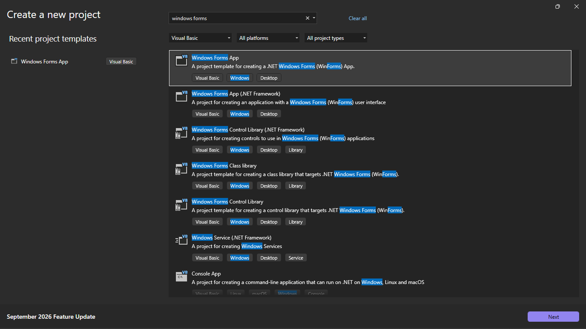

   Pilih **Windows Forms App**, bukan **Windows Forms App (.NET Framework)** yang letaknya tepat di bawahnya.

3. Aktifkan Option Strict: klik kanan proyek di Solution Explorer, pilih **Properties**, buka bagian **Compile**, lalu atur **Option strict** menjadi **On**.

   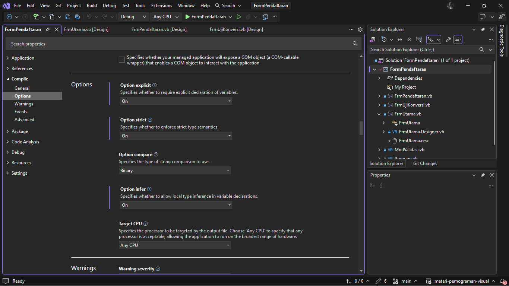

4. Di Solution Explorer, klik kanan `Form1.vb`, pilih **Rename**, ganti menjadi `FrmUtama.vb`. Jika Visual Studio bertanya apakah semua referensi ikut diganti, pilih **Yes**. Setelah itu, pastikan **Startup form** di Project Properties bagian **Application** sudah berisi `FrmUtama`.
5. Klik form di Designer, lalu atur propertinya:

| Properti | Nilai |
|---|---|
| (Name) | FrmUtama |
| Text | Pertemuan 7 - Validasi & Error Handling |
| ClientSize | 420; 220 |
| StartPosition | CenterScreen |
| FormBorderStyle | FixedSingle |
| MaximizeBox | False |

6. Tambahkan satu Label sebagai judul:

| Kontrol | (Name) | Text | Properti lain |
|---|---|---|---|
| Label | lblJudul | Contoh Pertemuan 7 | Font: Segoe UI, 14pt, Bold |

Ganti `(Name)` setiap kontrol **sebelum** membuat event, supaya nama Sub event-nya ikut benar.

## Praktik 1: Form Uji Konversi

### 1.1 Membuat form

1. Klik kanan proyek, pilih **Add** > **Form (Windows Forms)**, beri nama `FrmUjiKonversi.vb`.
2. Atur properti form:

| Properti | Nilai |
|---|---|
| Text | Uji Konversi Input |
| ClientSize | 640; 340 |
| StartPosition | CenterScreen |
| FormBorderStyle | FixedSingle |
| MaximizeBox | False |

3. Tambahkan kontrol berikut, lalu susun seperti gambar di bawah:

| Kontrol | (Name) | Text | Properti lain |
|---|---|---|---|
| Label | lblJudul | Uji Konversi Input | Font: Segoe UI, 14pt, Bold |
| Label | lblPetunjuk | Ketik sebuah nilai lalu coba setiap tombol. Coba: 25, abc, 12abc, 3,5, 99999999999, atau kosong. | AutoSize: False |
| Label | lblInput | Input: | |
| TextBox | txtInput | | |
| Button | btnCInt | CInt (tanpa Try) | |
| Button | btnVal | Val | |
| Button | btnTryParse | TryParse | |
| Button | btnTryCatch | Try...Catch | |
| Button | btnCatchBertingkat | Catch Bertingkat | |
| Label | lblHasil | Hasil akan tampil di sini. | AutoSize: False, BorderStyle: FixedSingle, Padding: 8 |

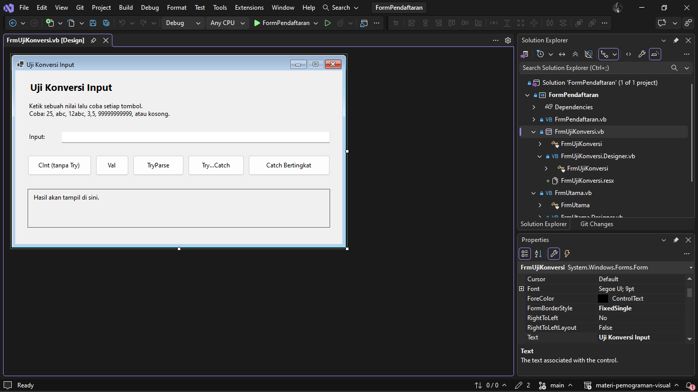

### 1.2 Menulis kode

Double-click setiap tombol di Designer untuk membuat Sub event-nya, lalu isi seperti kode berikut. Kode lengkap `FrmUjiKonversi.vb`:

```vb
Option Strict On

Public Class FrmUjiKonversi
    ' Tanpa penanganan error: input "abc" membuat program berhenti (InvalidCastException)
    Private Sub btnCInt_Click(sender As Object, e As EventArgs) Handles btnCInt.Click
        Dim angka As Integer = CInt(txtInput.Text)
        lblHasil.Text = "CInt berhasil: " & angka.ToString()
    End Sub

    ' Val tidak pernah error, tetapi diam-diam menghasilkan angka yang bisa salah
    Private Sub btnVal_Click(sender As Object, e As EventArgs) Handles btnVal.Click
        Dim angka As Double = Val(txtInput.Text)
        lblHasil.Text = "Val menghasilkan: " & angka.ToString()
    End Sub

    Private Sub btnTryParse_Click(sender As Object, e As EventArgs) Handles btnTryParse.Click
        Dim angka As Integer
        If Integer.TryParse(txtInput.Text, angka) Then
            lblHasil.Text = "Valid. Nilai angka = " & angka.ToString()
        Else
            lblHasil.Text = "Bukan bilangan bulat yang valid. Tidak ada exception."
        End If
    End Sub

    Private Sub btnTryCatch_Click(sender As Object, e As EventArgs) Handles btnTryCatch.Click
        Try
            Dim angka As Integer = Integer.Parse(txtInput.Text)
            lblHasil.Text = "Berhasil dikonversi: " & angka.ToString()
        Catch ex As Exception
            lblHasil.Text = "Konversi gagal, program tetap berjalan."
            MessageBox.Show("Input harus bilangan bulat, misalnya 25." & vbCrLf &
                            "Detail: " & ex.Message, "Input Tidak Valid",
                            MessageBoxButtons.OK, MessageBoxIcon.Warning)
        End Try
    End Sub

    Private Sub btnCatchBertingkat_Click(sender As Object, e As EventArgs) Handles btnCatchBertingkat.Click
        Try
            Dim angka As Integer = Integer.Parse(txtInput.Text)
            Dim hasil As Integer = 1000 \ angka
            lblHasil.Text = "1000 \ " & angka.ToString() & " = " & hasil.ToString()
        Catch ex As FormatException
            lblHasil.Text = "Format salah: input bukan bilangan bulat."
        Catch ex As OverflowException
            lblHasil.Text = "Angka terlalu besar untuk tipe Integer."
        Catch ex As DivideByZeroException
            lblHasil.Text = "Pembagian dengan nol tidak diperbolehkan."
        Catch ex As Exception
            lblHasil.Text = "Error lain: " & ex.Message
        End Try
    End Sub
End Class
```

### 1.3 Menghubungkan ke FrmUtama

1. Buka FrmUtama di Designer, lalu tambahkan tombol:

| Kontrol | (Name) | Text |
|---|---|---|
| Button | btnUjiKonversi | Uji Konversi: CInt, Val, TryParse, Try...Catch |

2. Double-click tombol itu, lalu isi:

```vb
    ' Membuka contoh konversi input.
    Private Sub btnUjiKonversi_Click(sender As Object, e As EventArgs) Handles btnUjiKonversi.Click
        Dim frm As New FrmUjiKonversi()
        frm.ShowDialog()
    End Sub
```

### 1.4 Menjalankan dan menguji

Tekan **F5**, klik tombol Uji Konversi, lalu coba langkah berikut:

| No | Langkah | Hasil yang benar |
|---|---|---|
| 1 | Ketik `25`, klik setiap tombol | Semua tombol berhasil; Catch Bertingkat menampilkan `1000 \ 25 = 40` |
| 2 | Ketik `abc`, klik **Try...Catch** | Muncul MessageBox "Input Tidak Valid" dan program tetap berjalan |
| 3 | Ketik `abc`, klik **TryParse** | lblHasil berisi "Bukan bilangan bulat yang valid", tanpa MessageBox |
| 4 | Ketik `0`, klik **Catch Bertingkat** | lblHasil berisi "Pembagian dengan nol tidak diperbolehkan." |
| 5 | Ketik `abc`, klik **CInt (tanpa Try)** | Visual Studio berhenti di baris `CInt` dan menampilkan jendela Exception User-Unhandled. Ini memang disengaja. Tekan Stop untuk keluar |

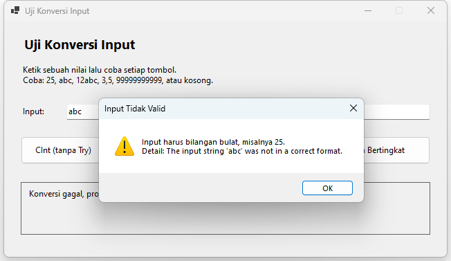

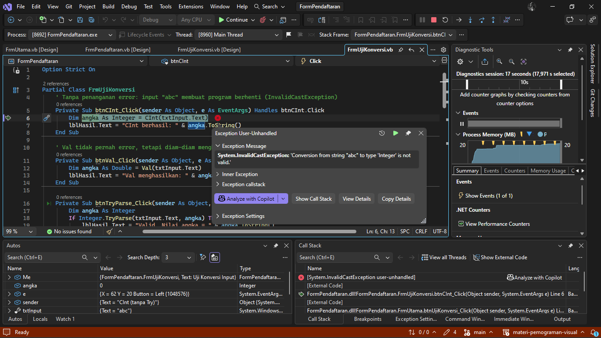

## Praktik 2: Form Pendaftaran Mahasiswa

### 2.1 Membuat Module validasi

1. Klik kanan proyek, pilih **Add** > **Module**, beri nama `ModValidasi.vb`.
2. Isi seluruhnya dengan kode berikut:

```vb
Option Strict On

Imports System.Globalization

' Kumpulan fungsi validasi yang bisa dipakai ulang oleh form mana pun
Public Module ModValidasi

    ' True jika teks kosong atau hanya berisi spasi
    Public Function Kosong(teks As String) As Boolean
        Return teks.Trim() = ""
    End Function

    ' True jika panjang teks tepat sesuai dan semua karakternya digit 0-9
    Public Function SemuaDigit(teks As String, panjang As Integer) As Boolean
        If teks.Length <> panjang Then Return False
        For Each karakter As Char In teks
            If karakter < "0"c OrElse karakter > "9"c Then Return False
        Next
        Return True
    End Function

    ' Mengubah teks desimal menjadi Decimal. Koma dan titik sama-sama diterima,
    ' sehingga hasilnya tidak bergantung pada pengaturan bahasa Windows.
    Public Function CobaDesimal(teks As String, ByRef hasil As Decimal) As Boolean
        Dim teksTitik As String = teks.Trim().Replace(",", ".")
        Return Decimal.TryParse(teksTitik, NumberStyles.AllowDecimalPoint,
                                CultureInfo.InvariantCulture, hasil)
    End Function

End Module
```

### 2.2 Membuat form

1. Tambahkan form baru bernama `FrmPendaftaran.vb`, lalu atur propertinya:

| Properti | Nilai |
|---|---|
| Text | Pendaftaran Mahasiswa |
| ClientSize | 780; 470 |
| StartPosition | CenterScreen |
| FormBorderStyle | FixedSingle |
| MaximizeBox | False |
| AcceptButton | btnSimpan (atur setelah tombol dibuat) |

2. Tambahkan kontrol berikut. Isian berada di kiri dan daftar data di kanan, seperti gambar.

| Kontrol | (Name) | Text | Properti lain |
|---|---|---|---|
| Label | lblJudul | Pendaftaran Mahasiswa | Font: Segoe UI, 14pt, Bold |
| Label | lblNim | NIM | |
| TextBox | txtNim | | MaxLength: 9 |
| Label | lblNama | Nama | |
| TextBox | txtNama | | MaxLength: 100 |
| Label | lblJurusan | Jurusan | |
| ComboBox | cboJurusan | | DropDownStyle: DropDownList |
| Label | lblAngkatan | Angkatan | |
| TextBox | txtAngkatan | | MaxLength: 4 |
| Label | lblIpk | IPK | |
| TextBox | txtIpk | | MaxLength: 4 |
| Button | btnSimpan | Simpan | |
| Button | btnBersihkan | Bersihkan | CausesValidation: False |
| Label | lblDaftar | Data tersimpan | |
| ListBox | lstMahasiswa | | HorizontalScrollbar: True, IntegralHeight: False |
| Button | btnEkspor | Ekspor ke CSV | CausesValidation: False |
| Label | lblStatus | Siap. | AutoSize: False, lebar selebar form |

3. Isi item `cboJurusan`: pilih ComboBox, klik properti **Items**, lalu ketik satu per baris:

```
Teknik Informatika
Sistem Informasi
Manajemen Informatika
Teknik Komputer
```

4. Tambahkan **ErrorProvider** dari Toolbox (grup Components). Komponen ini muncul di component tray di bawah form. Ganti `(Name)`-nya menjadi `errInput`.

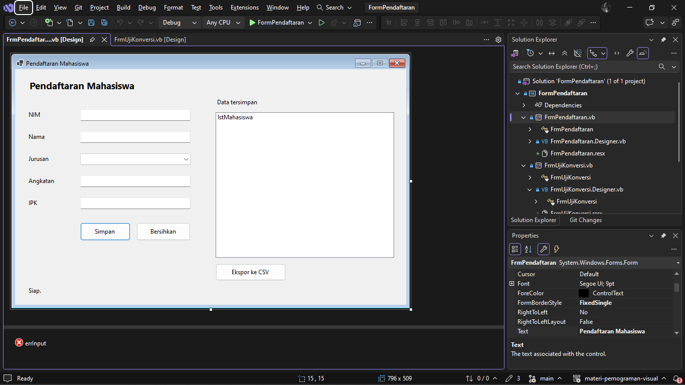

### 2.3 Menulis kode

Tulis kode `FrmPendaftaran.vb` bertahap. Sub event tombol dibuat dengan double-click tombolnya.

**a. Bagian atas file: Imports dan variabel form**

```vb
Option Strict On

Imports System.ComponentModel
Imports System.IO

Public Class FrmPendaftaran
    ' NIM yang sudah tersimpan, untuk mencegah data ganda
    Private ReadOnly daftarNim As New List(Of String)

    ' File CSV disimpan di folder Documents milik pengguna
    Private ReadOnly lokasiEkspor As String =
        Path.Combine(Environment.GetFolderPath(Environment.SpecialFolder.MyDocuments),
                     "data-mahasiswa.csv")
```

**b. Fungsi validasi**

```vb
    ' Memeriksa semua isian. Mengembalikan True jika semuanya valid.
    Private Function ValidasiInput() As Boolean
        errInput.Clear()                    ' hapus semua tanda error lama
        Dim valid As Boolean = True

        If Kosong(txtNama.Text) Then
            errInput.SetError(txtNama, "Nama wajib diisi.")
            valid = False
        End If

        Dim angkatan As Integer
        If Not Integer.TryParse(txtAngkatan.Text, angkatan) OrElse
           angkatan < 2015 OrElse angkatan > Date.Today.Year Then
            errInput.SetError(txtAngkatan, "Angkatan harus angka 2015 s.d. tahun ini.")
            valid = False
        End If

        If Not SemuaDigit(txtNim.Text, 9) Then
            errInput.SetError(txtNim, "NIM harus 9 digit angka.")
            valid = False
        ElseIf daftarNim.Contains(txtNim.Text) Then
            errInput.SetError(txtNim, "NIM sudah terdaftar.")
            valid = False
        End If

        If cboJurusan.SelectedIndex = -1 Then
            errInput.SetError(cboJurusan, "Pilih salah satu jurusan.")
            valid = False
        End If

        Dim ipk As Decimal
        If Not CobaDesimal(txtIpk.Text, ipk) OrElse ipk < 0D OrElse ipk > 4D Then
            errInput.SetError(txtIpk, "IPK harus angka 0,00 s.d. 4,00.")
            valid = False
        End If

        Return valid
    End Function
```

**c. Tombol Simpan**

```vb
    Private Sub btnSimpan_Click(sender As Object, e As EventArgs) Handles btnSimpan.Click
        If Not ValidasiInput() Then
            lblStatus.Text = "Periksa isian yang bertanda merah."
            Return
        End If
        ' Semua isian sudah valid, jadi konversi di bawah ini tidak perlu Try...Catch
        Dim ipk As Decimal
        CobaDesimal(txtIpk.Text, ipk)
        lstMahasiswa.Items.Add(txtNim.Text & " | " & txtNama.Text.Trim() & " | " &
                               cboJurusan.Text & " | " & txtAngkatan.Text & " | " & ipk.ToString("0.00"))
        daftarNim.Add(txtNim.Text)
        lblStatus.Text = "Data " & txtNama.Text.Trim() & " tersimpan."
        BersihkanForm()
    End Sub
```

**d. Event Validating pada txtNim**

Event ini tidak dibuat dengan double-click. Pilih `txtNim` di Designer, buka jendela Properties, klik ikon petir (**Events**), lalu double-click baris **Validating**.

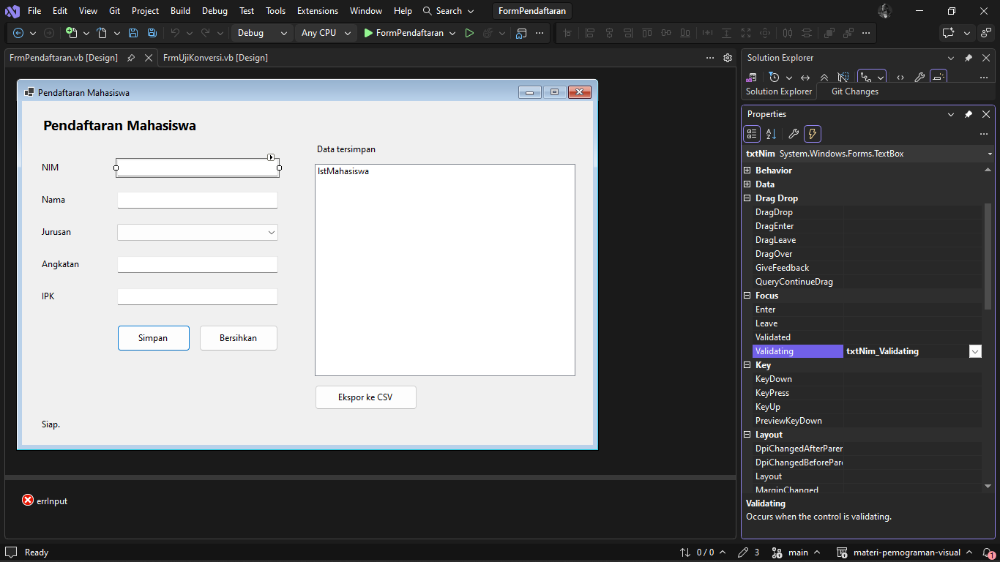

```vb
    ' Validasi per kontrol: berjalan saat fokus meninggalkan txtNim
    Private Sub txtNim_Validating(sender As Object, e As CancelEventArgs) Handles txtNim.Validating
        If txtNim.Text = "" Then Return         ' kosong dicek nanti saat Simpan
        If SemuaDigit(txtNim.Text, 9) Then
            errInput.SetError(txtNim, "")
        Else
            errInput.SetError(txtNim, "NIM harus 9 digit angka.")
            ' e.Cancel = True akan menahan fokus di txtNim. Sengaja tidak dipakai.
        End If
    End Sub
```

**e. Tombol Ekspor**

```vb
    Private Sub btnEkspor_Click(sender As Object, e As EventArgs) Handles btnEkspor.Click
        Dim penulis As StreamWriter = Nothing
        Try
            penulis = New StreamWriter(lokasiEkspor)
            For Each baris As Object In lstMahasiswa.Items
                penulis.WriteLine(baris.ToString().Replace(" | ", ";"))
            Next
            lblStatus.Text = "Data diekspor ke " & lokasiEkspor
        Catch ex As IOException
            MessageBox.Show("File sedang dipakai program lain atau tidak bisa ditulis." &
                            vbCrLf & ex.Message, "Ekspor Gagal")
        Finally
            If penulis IsNot Nothing Then penulis.Close()   ' file selalu ditutup
        End Try
    End Sub
```

**f. Membersihkan form**

```vb
    ' Mengosongkan isian untuk pendaftaran berikutnya.
    Private Sub BersihkanForm()
        txtNim.Clear()
        txtNama.Clear()
        txtAngkatan.Clear()
        txtIpk.Clear()
        cboJurusan.SelectedIndex = -1
        errInput.Clear()
        txtNim.Focus()
    End Sub

    Private Sub btnBersihkan_Click(sender As Object, e As EventArgs) Handles btnBersihkan.Click
        BersihkanForm()
        lblStatus.Text = "Form dibersihkan."
    End Sub
End Class
```

### 2.4 Menghubungkan ke FrmUtama

1. Di FrmUtama, tambahkan tombol:

| Kontrol | (Name) | Text |
|---|---|---|
| Button | btnPendaftaran | Form Pendaftaran Mahasiswa |

2. Double-click tombol itu, lalu isi:

```vb
    ' Membuka studi kasus pendaftaran.
    Private Sub btnPendaftaran_Click(sender As Object, e As EventArgs) Handles btnPendaftaran.Click
        Dim frm As New FrmPendaftaran()
        frm.ShowDialog()
    End Sub
```

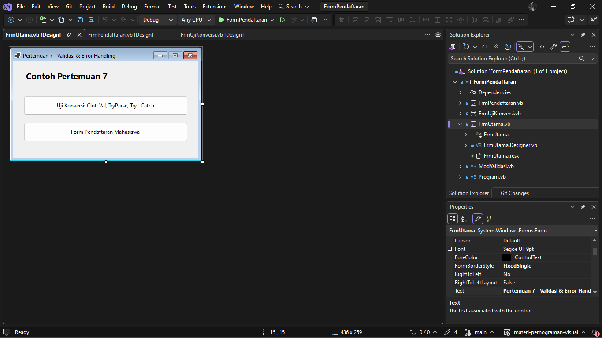

### 2.5 Menjalankan dan menguji

Tekan **F5**, buka Form Pendaftaran Mahasiswa, lalu coba langkah berikut:

| No | Langkah | Hasil yang benar |
|---|---|---|
| 1 | Klik **Simpan** tanpa mengisi apa pun | Ikon merah muncul di samping semua isian; arahkan mouse ke ikon untuk melihat pesannya |
| 2 | Ketik NIM `12345`, lalu tekan Tab | Ikon merah langsung muncul di txtNim (event Validating) |
| 3 | Isi data lengkap: NIM `231712001`, Nama `Andi Pratama`, jurusan apa saja, Angkatan `2023`, IPK `3,45`, klik **Simpan** | Data masuk ke daftar, form kosong lagi, lblStatus "Data Andi Pratama tersimpan." |
| 4 | Simpan data kedua dengan IPK memakai titik, misalnya `3.8` | Diterima; IPK tampil dengan dua angka desimal (3,80 atau 3.80, mengikuti pengaturan bahasa Windows) |
| 5 | Masukkan lagi NIM `231712001` | Ikon merah dengan pesan "NIM sudah terdaftar." |
| 6 | Isi beberapa kolom dengan data salah, lalu klik **Bersihkan** | Isian dan semua ikon merah hilang |
| 7 | Klik **Ekspor ke CSV** | lblStatus menampilkan lokasi file `data-mahasiswa.csv` di folder Documents |
| 8 | Buka `data-mahasiswa.csv` di Excel, lalu klik **Ekspor ke CSV** lagi tanpa menutup Excel | Muncul MessageBox "Ekspor Gagal" dan program tetap berjalan |

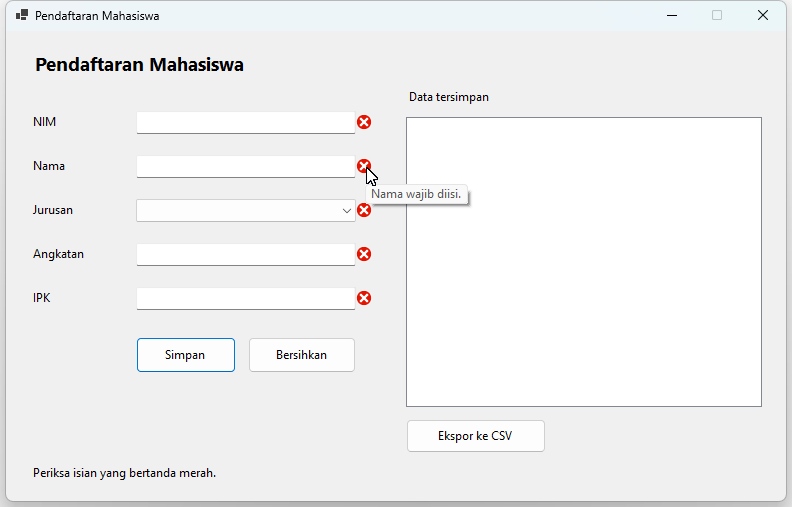

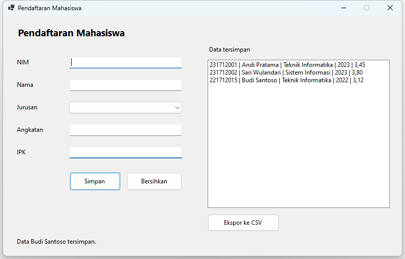

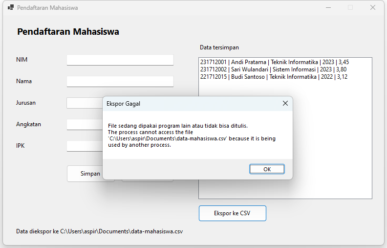
