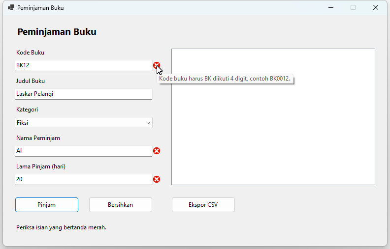
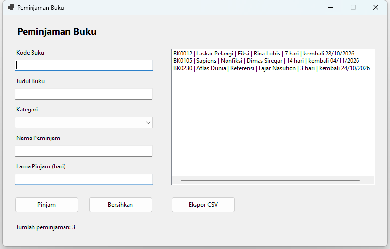

# Tugas Pertemuan 7: Form Peminjaman Buku

Mata kuliah Pemrograman Visual (TIF 3 031). Tugas individu.

## Deskripsi kasus

Perpustakaan program studi masih mencatat peminjaman buku di kertas. Petugas sering salah menulis kode buku, lupa menghitung tanggal kembali, dan tanpa sadar meminjamkan buku yang sebenarnya sedang dipinjam orang lain.

Buat aplikasi Windows Forms dengan satu form untuk mencatat peminjaman. Form harus menolak isian yang salah sebelum data dicatat, menandai kontrol yang salah dengan ErrorProvider, dan tetap berjalan (tidak crash) ketika file ekspor tidak bisa ditulis.

Kasus ini berbeda dari contoh di kelas (pendaftaran mahasiswa). Konsepnya sama, tetapi aturan validasinya baru dan ada fitur tambahan: format kode yang terdiri dari huruf dan angka, perhitungan tanggal kembali, serta dua jenis exception pada ekspor.

## Kontrol

| Kontrol | Nama | Keterangan |
|---|---|---|
| Label | lblJudulForm | Judul form "Peminjaman Buku" |
| TextBox | txtKodeBuku | Kode buku |
| TextBox | txtJudul | Judul buku |
| ComboBox | cboKategori | DropDownList berisi Fiksi, Nonfiksi, Referensi, Majalah |
| TextBox | txtNamaPeminjam | Nama peminjam |
| TextBox | txtLamaPinjam | Lama pinjam dalam hari |
| Button | btnPinjam | Mencatat peminjaman |
| Button | btnBersihkan | Mengosongkan form |
| ListBox | lstPeminjaman | Daftar peminjaman |
| Button | btnEkspor | Menyimpan daftar ke file CSV |
| Label | lblStatus | Status dan jumlah peminjaman |
| ErrorProvider | errPinjam | Penanda isian yang salah |

Setiap TextBox dan ComboBox diberi Label keterangan dengan prefix `lbl` (misalnya `lblKodeBuku`).

## Contoh tampilan

Tata letak boleh berbeda, asalkan semua kontrol pada tabel di atas ada dan namanya sesuai.

Pada contoh kedua, kode `bk0105` diketik dengan huruf kecil lalu tersimpan sebagai `BK0105`.

## Fitur wajib

1. **Rancangan form.** Semua kontrol pada tabel di atas dibuat lewat Designer dengan nama yang sama persis. Tidak ada kontrol bernama default seperti `Label1` atau `Button1`.
2. **Validasi terpusat.** Semua pemeriksaan ada di satu `Function ValidasiInput() As Boolean` yang memakai `errPinjam`. Semua isian diperiksa sekaligus, bukan berhenti di kesalahan pertama. Tidak boleh ada MessageBox untuk kesalahan validasi.
   - `txtKodeBuku`: "BK" diikuti 4 digit, contoh `BK0012`. Huruf kecil (`bk0012`) tetap diterima dan disimpan sebagai huruf besar.
   - `txtJudul`: wajib diisi.
   - `cboKategori`: wajib dipilih.
   - `txtNamaPeminjam`: minimal 3 karakter, tidak termasuk spasi di awal dan akhir.
   - `txtLamaPinjam`: bilangan bulat 1 sampai 14, dibaca dengan `Integer.TryParse`, bukan `Val` atau `CInt`.
3. **Buku tidak bisa dipinjam dua kali.** Kode buku yang sudah dipinjam disimpan di `List(Of String)`. Jika kode yang sama dimasukkan lagi, tampilkan pesan "Buku ini sedang dipinjam." di ErrorProvider.
4. **Tombol Pinjam.** Jika semua isian valid, tambahkan satu baris ke `lstPeminjaman` dengan format:
   `BK0012 | Laskar Pelangi | Fiksi | Rina Lubis | 7 hari | kembali 28/10/2026`
   Tanggal kembali adalah hari ini ditambah lama pinjam. Setelah itu `lblStatus` menampilkan "Jumlah peminjaman: N" dan form dikosongkan.
5. **Tombol Bersihkan.** Mengosongkan semua isian dan menghapus semua ikon ErrorProvider. Atur `CausesValidation = False` pada tombol ini.
6. **Tombol Ekspor.** Isi `lstPeminjaman` ditulis ke file `peminjaman.csv` di folder Documents. Pemisah kolomnya titik koma (`;`), dan baris pertama berisi judul kolom.
   - Jika daftar masih kosong, tampilkan pesan dan jangan membuat file.
   - Gunakan `Try...Catch...Finally` dengan `Catch ex As IOException` dan `Catch ex As UnauthorizedAccessException`, masing-masing dengan pesan yang menjelaskan apa yang harus dilakukan pengguna.
   - `StreamWriter` ditutup di blok `Finally`.

## Tantangan tambahan (nilai lebih)

1. Validasi `txtKodeBuku` juga di event `Validating`, sehingga kesalahan format langsung terlihat saat fokus pindah ke kontrol lain. Jangan memakai `e.Cancel = True`.
2. Pindahkan pemeriksaan format kode buku ke Module sebagai `Public Function KodeBukuValid(kode As String) As Boolean`, lalu pakai fungsi itu di `ValidasiInput()` dan di event `Validating`.

## Petunjuk

- Memeriksa awalan dan memotong teks: `kode.StartsWith("BK")` bernilai True jika kode diawali "BK", dan `kode.Substring(2)` menghasilkan teks mulai karakter ketiga ("BK0012" menjadi "0012"). Periksa dulu `kode.Length = 6` agar `Substring` aman.
- Pemeriksaan 4 digit bisa memakai fungsi `SemuaDigit` dari contoh di kelas.
- Tanggal kembali: `Date.Today.AddDays(lamaPinjam).ToString("dd/MM/yyyy")`.
- Lokasi file: `Path.Combine(Environment.GetFolderPath(Environment.SpecialFolder.MyDocuments), "peminjaman.csv")`, sama seperti contoh di kelas.
- Untuk menguji `IOException`: buka `peminjaman.csv` di Excel, lalu klik Ekspor lagi tanpa menutup Excel.

## Ketentuan

1. Proyek Windows Forms VB.NET (.NET 10) dengan `Option Strict On`.
2. Nama kontrol mengikuti naming convention pada tabel kontrol.
3. Semua kontrol dibuat di Designer, dan form harus bisa dibuka di Designer Visual Studio tanpa error. Kontrol yang dibuat lewat kode tidak dinilai.
4. Hanya memakai materi Pertemuan 1 sampai 7.
5. Setiap Sub dan Function diberi komentar singkat yang menjelaskan fungsinya.
6. Dikumpulkan di LMS **kelas.usu.ac.id** sebelum batas waktu yang tertera di LMS, berisi:
   - source code: folder proyek dalam bentuk `.zip` tanpa folder `bin` dan `obj`, dengan nama `NIM_Nama_Tugas07.zip`
   - screenshot hasil (boleh digabung dalam satu PDF):
     1. form dengan ikon ErrorProvider pada beberapa isian yang salah
     2. `lstPeminjaman` berisi minimal tiga peminjaman
     3. pesan yang muncul ketika ekspor gagal karena file sedang dibuka di Excel

## Kriteria penilaian

| Kriteria | Bobot | Yang diperiksa pada tugas ini |
|---|---|---|
| Kesesuaian fungsionalitas dengan spesifikasi tugas | 25% | Fitur wajib 1 sampai 6 berjalan, termasuk kasus khusus (kode huruf kecil, buku dipinjam dua kali, daftar kosong saat ekspor) |
| Struktur & kualitas kode (penamaan kontrol, modularitas) | 20% | Nama kontrol sesuai tabel, validasi terpusat di `ValidasiInput()`, form bisa dibuka di Designer |
| Implementasi konsep VB sesuai materi | 20% | `TryParse`, `List(Of String)`, `Try...Catch...Finally` dengan dua Catch, If/For Each yang tepat |
| Interaksi data / komponen visual | 20% | ErrorProvider, ComboBox, ListBox, dan ekspor CSV bekerja dengan benar |
| Penanganan error & validasi input | 10% | Semua aturan validasi terpenuhi, pesan jelas, program tidak pernah crash |
| Ketepatan waktu & dokumentasi kode | 5% | Dikumpulkan tepat waktu, sesuai format, dan kode diberi komentar |
