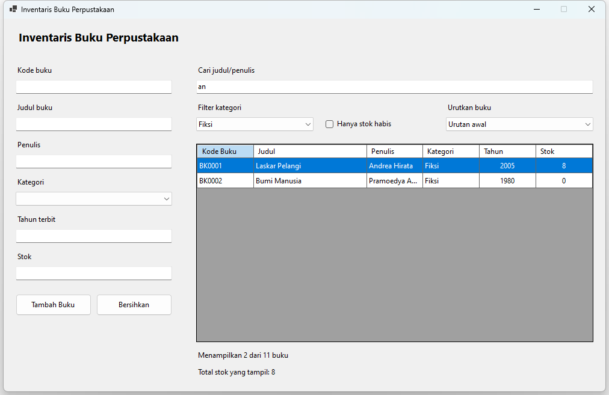

<div align="center">

# Lab 08 — Data Binding, DataGridView & Pencarian Data

[](https://learn.microsoft.com/dotnet/visual-basic/)
[](https://learn.microsoft.com/dotnet/desktop/winforms/)
[](#)

<p align="center">
  Dokumentasi proyek formulir <b>Inventaris Buku</b> menggunakan DataGridView yang terikat secara data-binding dua arah via BindingSource dan DataTable, dilengkapi fitur validasi, penambahan data, pencarian multi-kriteria secara instan (real-time filtering), pengurutan kustom, serta kalkulasi stok otomatis.
</p>

[📌 Ringkasan Proyek](#-ringkasan-proyek) •
[🧱 Komponen & Setup UI](#-komponen--setup-ui) •
[💻 Implementasi Kode](#-implementasi-kode) •
[⚙️ Bedah Teknis](#️-bedah-teknis) •
[📸 Tampilan Antarmuka](#-tampilan-antarmuka)

</div>

---

### 📌 Ringkasan Proyek

Aplikasi **Inventaris Buku** (`InventarisBuku`) dirancang untuk mengelola katalog data buku secara terstruktur dengan memanfaatkan arsitektur Data Binding pada Windows Forms:

1. **Two-Way Data Binding (`DataTable` &rarr; `BindingSource` &rarr; `DataGridView`)**: Seluruh manipulasi data (penambahan, pemfilteran, pengurutan) dilakukan pada layer data (`BindingSource`/`DataTable`) dan secara otomatis merefleksikan perubahan ke tampilan grid tanpa perlu memanipulasi baris grid secara manual.
2. **Real-time Multi-Criteria Filtering**: Filter dinamis saat pengguna mengetik kata kunci (mencakup `Judul` atau `Penulis`), menyaring `Kategori`, serta opsi menampilkan buku dengan stok habis (`Stok = 0`).
3. **Escaping Karakter Khusus Filter (`ModPencarian`)**: Mencegah eror sintaks filter ekspresi (seperti injeksi tanda petik tunggal atau karakter wildcard `[`, `]`, `*`, `%`).
4. **Validasi Input Non-Blocking**: Menggunakan `ErrorProvider` untuk memvalidasi format kode buku (`BK` + 4 digit), keunikan kode buku, judul, penulis, kategori, tahun terbit valid (1900 – tahun sekarang), dan stok non-negatif.
5. **Kalkulasi & Agregasi Real-Time**: Menghitung secara dinamis jumlah buku yang sedang terlihat serta total stok buku yang lolos penyaringan.

---

### 🧱 Komponen & Setup UI

Daftar kontrol utama pada `FrmInventarisBuku.vb [Design]`:

| Kontrol | Nama Kontrol | Konfigurasi Properti Utama | Fungsi & Deskripsi |
| :--- | :--- | :--- | :--- |
| `TextBox` | `txtKodeBuku` | `CharacterCasing: Normal` | Input kode unik buku (Format: `BK0001`) |
| `TextBox` | `txtJudul` | - | Input judul buku |
| `TextBox` | `txtPenulis` | - | Input nama penulis buku |
| `ComboBox` | `cboKategori` | `DropDownStyle: DropDownList` | Pilihan kategori: *Fiksi, Nonfiksi, Referensi, Majalah* |
| `TextBox` | `txtTahun` | - | Input tahun terbit buku (1900 - tahun ini) |
| `TextBox` | `txtStok` | - | Input kuantitas stok buku (bilangan bulat $\ge 0$) |
| `Button` | `btnTambah` | `Text: "Tambah Buku"` | Menjalankan validasi dan menambahkan entri ke `DataTable` |
| `Button` | `btnBersihkan` | `Text: "Bersihkan"` | Reset seluruh isian formulir dan pesan eror |
| `TextBox` | `txtCari` | `PlaceholderText: "Cari judul / penulis..."` | Filter teks pencarian real-time |
| `ComboBox` | `cboFilterKategori` | `DropDownStyle: DropDownList` | Filter data berdasarkan kategori buku |
| `CheckBox` | `chkStokHabis` | `Text: "Hanya stok habis"` | Filter khusus untuk menampilkan buku dengan stok 0 |
| `ComboBox` | `cboUrut` | `DropDownStyle: DropDownList` | Mengatur urutan tampilan (*Judul A-Z, Tahun terbaru, Stok terbanyak*) |
| `DataGridView`| `dgvBuku` | `ReadOnly: True`, `SelectionMode: FullRowSelect` | Menampilkan data buku melalui `bsBuku` |
| `Label` | `lblJumlah` | - | Menampilkan rasio baris yang tampil vs total data |
| `Label` | `lblTotalStok` | - | Menghitung akumulasi total stok baris yang tampil |
| `ErrorProvider`| `errBuku` | `BlinkStyle: NeverBlink` | Menampilkan indikator kesalahan masukan data |
| `BindingSource`| `bsBuku` | - | Jembatan pengikat antara `DataTable` dan `DataGridView` |

---

### 💻 Implementasi Kode

Cuplikan implementasi utama dari berkas sumber kode:

#### 1. Arsitektur Binding & Inisialisasi Data (`FrmInventarisBuku.vb`)
```vb
Private tabelBuku As DataTable

Private Function InisialisasiTabelBuku() As DataTable
    Dim tabel As New DataTable("InventarisBuku")
    tabel.Columns.Add("KodeBuku", GetType(String))
    tabel.Columns.Add("Judul", GetType(String))
    tabel.Columns.Add("Penulis", GetType(String))
    tabel.Columns.Add("Kategori", GetType(String))
    tabel.Columns.Add("Tahun", GetType(Integer))
    tabel.Columns.Add("Stok", GetType(Integer))

    ' Memuat data awal
    tabel.Rows.Add("BK0001", "Laskar Pelangi", "Andrea Hirata", "Fiksi", 2005, 8)
    tabel.Rows.Add("BK0002", "Bumi Manusia", "Pramoedya Ananta Toer", "Fiksi", 1980, 0)
    ' ... data lainnya
    Return tabel
End Function

Private Sub FrmInventarisBuku_Load(sender As Object, e As EventArgs) Handles MyBase.Load
    tabelBuku = InisialisasiTabelBuku()
    bsBuku.DataSource = tabelBuku
    dgvBuku.DataSource = bsBuku

    cboFilterKategori.SelectedIndex = 0
    cboUrut.SelectedIndex = 0

    AturKolom()
    PerbaruiRingkasan()
End Sub
```

#### 2. Mekanisme Multi-Criteria Filtering Dinamis
```vb
Private Sub TerapkanFilter()
    If bsBuku Is Nothing OrElse tabelBuku Is Nothing Then Exit Sub

    Dim daftarSyarat As New List(Of String)()

    ' 1. Syarat pencarian kata pada Judul atau Penulis
    Dim kataCari As String = AmankanTeksFilter(txtCari.Text.Trim())
    If kataCari <> "" Then
        daftarSyarat.Add("(Judul LIKE '%" & kataCari & "%' OR Penulis LIKE '%" & kataCari & "%')")
    End If

    ' 2. Syarat pembatasan kategori
    If cboFilterKategori.SelectedIndex > 0 AndAlso cboFilterKategori.SelectedItem IsNot Nothing Then
        Dim kategoriDipilih As String = cboFilterKategori.SelectedItem.ToString()
        If kategoriDipilih <> "Semua" Then
            daftarSyarat.Add("Kategori = '" & AmankanTeksFilter(kategoriDipilih) & "'")
        End If
    End If

    ' 3. Tantangan: Syarat hanya buku dengan stok habis
    If chkStokHabis.Checked Then
        daftarSyarat.Add("Stok = 0")
    End If

    ' Penggabungan syarat dengan operator AND
    If daftarSyarat.Count = 0 Then
        bsBuku.RemoveFilter()
    Else
        bsBuku.Filter = String.Join(" AND ", daftarSyarat)
    End If

    PerbaruiRingkasan()
End Sub
```

#### 3. Keamanan Input Filter Ekspresi (`ModPencarian.vb`)
```vb
Public Module ModPencarian
    Public Function AmankanTeksFilter(teks As String) As String
        Dim hasil As String = ""
        For Each karakter As Char In teks
            Select Case karakter
                Case "'"c
                    hasil &= "''"
                Case "["c, "]"c, "*"c, "%"c
                    hasil &= "[" & karakter & "]"
                Case Else
                    hasil &= karakter
            End Select
        Next
        Return hasil
    End Function
End Module
```

---

### ⚙️ Bedah Teknis

1. **Separation of Concerns**: Logika pemfilteran dan sanitasi teks dialokasikan ke modul terpisah `ModPencarian`, memastikan kode UI di `FrmInventarisBuku` tetap bersih dan modular.
2. **Pengecekan Duplikasi Non-Database**: Validasi mengecek keberadaan `KodeBuku` yang sama langsung pada baris-baris `tabelBuku.Rows` sebelum mengizinkan penambahan buku baru.
3. **Penghitungan Stok Adaptif**: Fungsi `PerbaruiRingkasan()` mengiterasi baris-baris yang aktif pada `dgvBuku.Rows` (bukan seluruh baris di `DataTable`), sehingga angka agregasi stok langsung menyesuaikan hasil filter pencarian.

---

### 📸 Tampilan Antarmuka

| Contoh Penambahan Data | Contoh Filter & Pencarian |
| :---: | :---: |
|  |  |

