# Praktik Pertemuan 8: DataGridView, Array & Koleksi Data

Hasil akhir praktik ini adalah satu proyek bernama **DataMahasiswa** dengan lima form:

| Form | Isi |
|---|---|
| FrmUtama | Form pembuka berisi empat tombol |
| FrmDariArray | Mengisi DataGridView dari Array 2 dimensi |
| FrmDariList | Menampilkan dan menambah `List(Of Mahasiswa)` lewat BindingSource |
| FrmDataTable | DataTable, merapikan kolom, dan pencarian dengan `BindingSource.Filter` |
| FrmCariList | Pencarian pada `List(Of Mahasiswa)` dengan perulangan |

Semua data dibuat langsung di kode. Praktik ini tidak memakai database.

## Langkah 0: Membuat proyek

1. Buat proyek baru dengan template **Windows Forms App** (Visual Basic), nama `DataMahasiswa`, framework **.NET 10**.
2. Aktifkan **Option strict = On** di Project Properties bagian **Compile**, seperti di Pertemuan 7.
3. Rename `Form1.vb` menjadi `FrmUtama.vb` (pastikan **Startup form** di Project Properties bagian **Application** berisi `FrmUtama`), lalu atur properti form:

| Properti | Nilai |
|---|---|
| Text | Pertemuan 8 - DataGridView, Array & Koleksi Data |
| ClientSize | 440; 300 |
| StartPosition | CenterScreen |
| FormBorderStyle | FixedSingle |
| MaximizeBox | False |

4. Tambahkan Label judul:

| Kontrol | (Name) | Text | Properti lain |
|---|---|---|---|
| Label | lblJudul | Contoh Pertemuan 8 | Font: Segoe UI, 14pt, Bold |

5. Salin Module validasi dari Pertemuan 7: klik kanan proyek, pilih **Add** > **Existing Item**, lalu pilih file `ModValidasi.vb` dari proyek FormPendaftaran. Visual Studio menyalin file itu ke proyek ini.

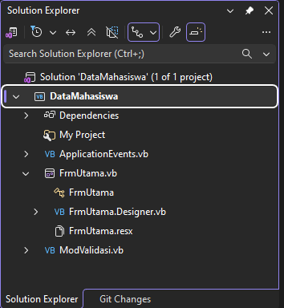

## Praktik 1: DataGridView dari Array

### 1.1 Membuat form

1. Tambahkan form baru `FrmDariArray.vb`, lalu atur propertinya:

| Properti | Nilai |
|---|---|
| Text | DataGridView dari Array |
| ClientSize | 720; 400 |
| StartPosition | CenterScreen |
| FormBorderStyle | FixedSingle |
| MaximizeBox | False |

2. Tambahkan kontrol berikut. DataGridView ada di Toolbox grup **Data**.

| Kontrol | (Name) | Text | Properti lain |
|---|---|---|---|
| Label | lblJudul | Data dari Array 2 Dimensi | Font: Segoe UI, 14pt, Bold |
| DataGridView | dgvMahasiswa | | lihat tabel di bawah |
| Button | btnTampilkan | Tampilkan | |
| Button | btnKosongkan | Kosongkan | |
| Label | lblJumlah | Jumlah data: 0 | |

3. Atur properti `dgvMahasiswa` di jendela Properties:

| Properti | Nilai |
|---|---|
| AllowUserToAddRows | False |
| AllowUserToDeleteRows | False |
| ReadOnly | True |
| SelectionMode | FullRowSelect |
| MultiSelect | False |
| AutoSizeColumnsMode | Fill |

### 1.2 Membuat kolom grid

1. Klik `dgvMahasiswa`, klik panah kecil di pojok kanan atas (smart tag), lalu pilih **Edit Columns**.
2. Klik **Add** lima kali untuk membuat kolom berikut:

| (Name) | HeaderText |
|---|---|
| colNim | NIM |
| colNama | Nama |
| colJurusan | Jurusan |
| colAngkatan | Angkatan |
| colIpk | IPK |

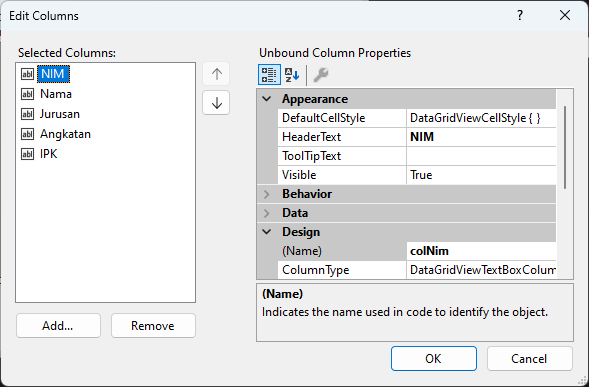

Daftar Selected Columns di kiri menampilkan HeaderText. Klik setiap kolom untuk memeriksa (Name)-nya di sebelah kanan.

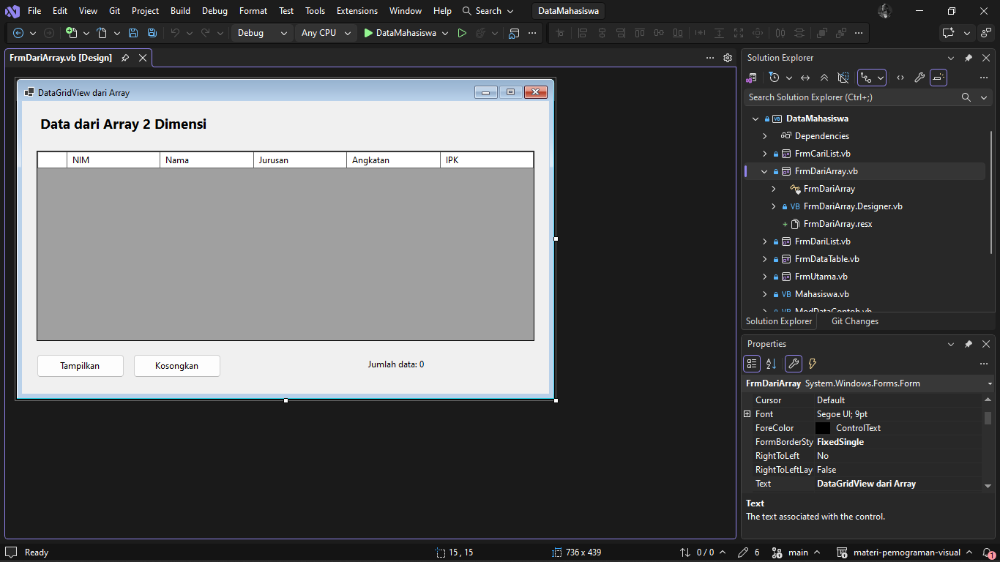

### 1.3 Menulis kode

Double-click `btnTampilkan` dan `btnKosongkan`, lalu lengkapi `FrmDariArray.vb`:

```vb
Option Strict On

Public Class FrmDariArray
    ' Array 2 dimensi: dimensi pertama = baris (mahasiswa).
    ' Dimensi kedua = kolom (NIM, Nama, Jurusan, Angkatan, IPK).
    Private ReadOnly dataMahasiswa(,) As String = {
        {"231712001", "Andi Pratama", "Teknik Informatika", "2023", "3.45"},
        {"231712002", "Sari Wulandari", "Sistem Informasi", "2023", "3.8"},
        {"221712015", "Budi Santoso", "Teknik Informatika", "2022", "3.12"},
        {"241712007", "Dimas Siregar", "Teknik Komputer", "2024", "2.95"},
        {"221712020", "Rina Marpaung", "Manajemen Informatika", "2022", "3.5"},
        {"241712011", "Putri Lubis", "Sistem Informasi", "2024", "3.91"},
        {"231712019", "Fajar Nasution", "Teknik Informatika", "2023", "3.28"},
        {"221712031", "Maya Sari Hasibuan", "Teknik Komputer", "2022", "3.55"}
    }

    Private Sub btnTampilkan_Click(sender As Object, e As EventArgs) Handles btnTampilkan.Click
        dgvMahasiswa.Rows.Clear()
        For i As Integer = 0 To dataMahasiswa.GetUpperBound(0)          ' baris
            Dim indeksBaris As Integer = dgvMahasiswa.Rows.Add()
            For j As Integer = 0 To dataMahasiswa.GetUpperBound(1)      ' kolom
                dgvMahasiswa.Rows(indeksBaris).Cells(j).Value = dataMahasiswa(i, j)
            Next
        Next
        lblJumlah.Text = "Jumlah data: " & dgvMahasiswa.Rows.Count.ToString()
    End Sub

    Private Sub btnKosongkan_Click(sender As Object, e As EventArgs) Handles btnKosongkan.Click
        dgvMahasiswa.Rows.Clear()
        lblJumlah.Text = "Jumlah data: 0"
    End Sub
End Class
```

### 1.4 Menghubungkan ke FrmUtama

Di FrmUtama, tambahkan tombol `btnDariArray` dengan Text `1. DataGridView dari Array`. Double-click, lalu isi:

```vb
    Private Sub btnDariArray_Click(sender As Object, e As EventArgs) Handles btnDariArray.Click
        Dim frm As New FrmDariArray()
        frm.ShowDialog()
    End Sub
```

### 1.5 Menjalankan dan menguji

| No | Langkah | Hasil yang benar |
|---|---|---|
| 1 | Klik **Tampilkan** | Grid berisi 8 baris, lblJumlah "Jumlah data: 8" |
| 2 | Klik **Tampilkan** sekali lagi | Tetap 8 baris, tidak dobel |
| 3 | Klik satu sel | Satu baris penuh terpilih; sel tidak bisa diketik |
| 4 | Klik **Kosongkan** | Grid kosong, lblJumlah "Jumlah data: 0" |

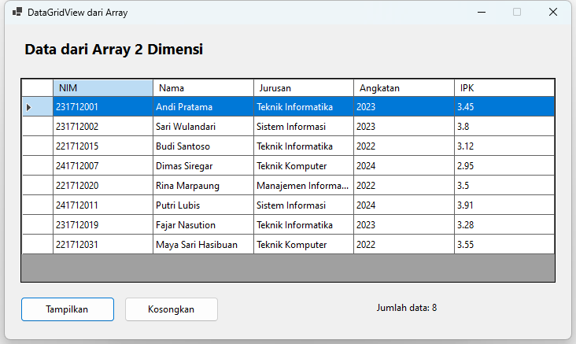

## Praktik 2: List(Of Mahasiswa) dan BindingSource

### 2.1 Membuat Class Mahasiswa

Klik kanan proyek, pilih **Add** > **Class**, beri nama `Mahasiswa.vb`, lalu isi:

```vb
Option Strict On

' Satu objek Mahasiswa mewakili satu baris data.
' DataGridView membaca setiap Public Property sebagai satu kolom.
Public Class Mahasiswa
    Public Property Nim As String
    Public Property Nama As String
    Public Property Jurusan As String
    Public Property Angkatan As Integer
    Public Property Ipk As Decimal

    Public Sub New(nim As String, nama As String, jurusan As String, angkatan As Integer, ipk As Decimal)
        Me.Nim = nim
        Me.Nama = nama
        Me.Jurusan = jurusan
        Me.Angkatan = angkatan
        Me.Ipk = ipk
    End Sub
End Class
```

### 2.2 Membuat form

1. Tambahkan form baru `FrmDariList.vb`, lalu atur propertinya:

| Properti | Nilai |
|---|---|
| Text | Binding List(Of Mahasiswa) |
| ClientSize | 760; 470 |
| StartPosition | CenterScreen |
| FormBorderStyle | FixedSingle |
| MaximizeBox | False |
| AcceptButton | btnTambah (atur setelah tombol dibuat) |

2. Tambahkan kontrol berikut. Isian di bagian atas, grid di bawahnya.

| Kontrol | (Name) | Text | Properti lain |
|---|---|---|---|
| Label | lblJudul | List(Of Mahasiswa) + BindingSource | Font: Segoe UI, 14pt, Bold |
| Label | lblNim | NIM | |
| TextBox | txtNim | | MaxLength: 9 |
| Label | lblNama | Nama | |
| TextBox | txtNama | | |
| Label | lblJurusan | Jurusan | |
| ComboBox | cboJurusan | | DropDownStyle: DropDownList |
| Label | lblAngkatan | Angkatan | |
| TextBox | txtAngkatan | | MaxLength: 4 |
| Label | lblIpk | IPK | |
| TextBox | txtIpk | | MaxLength: 4 |
| Button | btnTambah | Tambah | |
| DataGridView | dgvMahasiswa | | AllowUserToAddRows: False, AllowUserToDeleteRows: False, ReadOnly: True, SelectionMode: FullRowSelect, MultiSelect: False, AutoSizeColumnsMode: Fill |
| Label | lblJumlah | Jumlah data: 0 | |

3. Isi **Items** `cboJurusan`: Teknik Informatika, Sistem Informasi, Manajemen Informatika, Teknik Komputer (satu per baris).
4. Tambahkan dua komponen. Keduanya muncul di component tray di bawah form.
   - **BindingSource** dari Toolbox grup **Data**, beri `(Name)` `bsMahasiswa`.
   - **ErrorProvider** dari Toolbox grup **Components**, beri `(Name)` `errInput`.
5. Jangan mengatur properti `DataSource` grid di Designer. Grid diisi lewat kode.

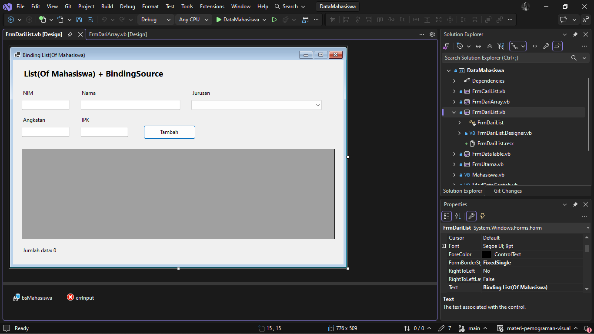

### 2.3 Menulis kode

Double-click area kosong form untuk membuat event `Load`, double-click `btnTambah`, lalu lengkapi `FrmDariList.vb`:

```vb
Option Strict On

Public Class FrmDariList
    Private ReadOnly daftarMahasiswa As New List(Of Mahasiswa)

    Private Sub FrmDariList_Load(sender As Object, e As EventArgs) Handles MyBase.Load
        daftarMahasiswa.Add(New Mahasiswa("231712001", "Andi Pratama", "Teknik Informatika", 2023, 3.45D))
        daftarMahasiswa.Add(New Mahasiswa("231712002", "Sari Wulandari", "Sistem Informasi", 2023, 3.8D))
        daftarMahasiswa.Add(New Mahasiswa("221712015", "Budi Santoso", "Teknik Informatika", 2022, 3.12D))
        daftarMahasiswa.Add(New Mahasiswa("241712007", "Dimas Siregar", "Teknik Komputer", 2024, 2.95D))

        bsMahasiswa.DataSource = daftarMahasiswa        ' List -> BindingSource
        dgvMahasiswa.DataSource = bsMahasiswa           ' BindingSource -> DataGridView
        lblJumlah.Text = "Jumlah data: " & bsMahasiswa.Count.ToString()
    End Sub

    Private Sub btnTambah_Click(sender As Object, e As EventArgs) Handles btnTambah.Click
        If Not ValidasiInput() Then Return
        Dim ipk As Decimal
        CobaDesimal(txtIpk.Text, ipk)
        Dim baru As New Mahasiswa(txtNim.Text, txtNama.Text.Trim(), cboJurusan.Text,
                                  Integer.Parse(txtAngkatan.Text), ipk)
        ' Tambah lewat BindingSource, bukan daftarMahasiswa.Add, agar grid langsung diperbarui
        bsMahasiswa.Add(baru)
        lblJumlah.Text = "Jumlah data: " & bsMahasiswa.Count.ToString()
        BersihkanInput()
    End Sub

    ' Periksa semua isian dan tampilkan kesalahan di samping kontrol.
    Private Function ValidasiInput() As Boolean
        errInput.Clear()
        Dim valid As Boolean = True
        Dim angkatan As Integer
        Dim ipk As Decimal

        If Not SemuaDigit(txtNim.Text, 9) Then
            errInput.SetError(txtNim, "NIM harus terdiri dari 9 digit.")
            valid = False
        Else
            For Each mhs As Mahasiswa In daftarMahasiswa
                If mhs.Nim = txtNim.Text Then
                    errInput.SetError(txtNim, "NIM sudah terdaftar.")
                    valid = False
                    Exit For
                End If
            Next
        End If
        If Kosong(txtNama.Text) Then
            errInput.SetError(txtNama, "Nama wajib diisi.")
            valid = False
        End If
        If cboJurusan.SelectedIndex = -1 Then
            errInput.SetError(cboJurusan, "Pilih jurusan terlebih dahulu.")
            valid = False
        End If
        If Not Integer.TryParse(txtAngkatan.Text, angkatan) OrElse
            angkatan < 2015 OrElse angkatan > Date.Today.Year Then
            errInput.SetError(txtAngkatan, "Angkatan harus antara 2015 dan tahun ini.")
            valid = False
        End If
        If Not CobaDesimal(txtIpk.Text, ipk) OrElse ipk < 0D OrElse ipk > 4D Then
            errInput.SetError(txtIpk, "IPK harus berupa angka antara 0 dan 4.")
            valid = False
        End If
        Return valid
    End Function

    Private Sub BersihkanInput()
        txtNim.Clear()
        txtNama.Clear()
        cboJurusan.SelectedIndex = -1
        txtAngkatan.Clear()
        txtIpk.Clear()
        errInput.Clear()
        txtNim.Focus()
    End Sub
End Class
```

### 2.4 Menghubungkan ke FrmUtama

Di FrmUtama, tambahkan tombol `btnDariList` dengan Text `2. Binding List(Of Mahasiswa)`. Double-click, lalu isi:

```vb
    Private Sub btnDariList_Click(sender As Object, e As EventArgs) Handles btnDariList.Click
        Dim frm As New FrmDariList()
        frm.ShowDialog()
    End Sub
```

### 2.5 Menjalankan dan menguji

| No | Langkah | Hasil yang benar |
|---|---|---|
| 1 | Buka form | Grid berisi 4 mahasiswa dengan kolom Nim, Nama, Jurusan, Angkatan, Ipk; lblJumlah "Jumlah data: 4" |
| 2 | Isi NIM `241712011`, Nama `Putri Lubis`, jurusan apa saja, Angkatan `2024`, IPK `3,91`, klik **Tambah** | Baris kelima langsung muncul di grid; lblJumlah "Jumlah data: 5" |
| 3 | Masukkan lagi NIM `231712001` | Ikon merah dengan pesan "NIM sudah terdaftar." |
| 4 | Klik **Tambah** dengan isian kosong | Ikon merah muncul di semua isian |

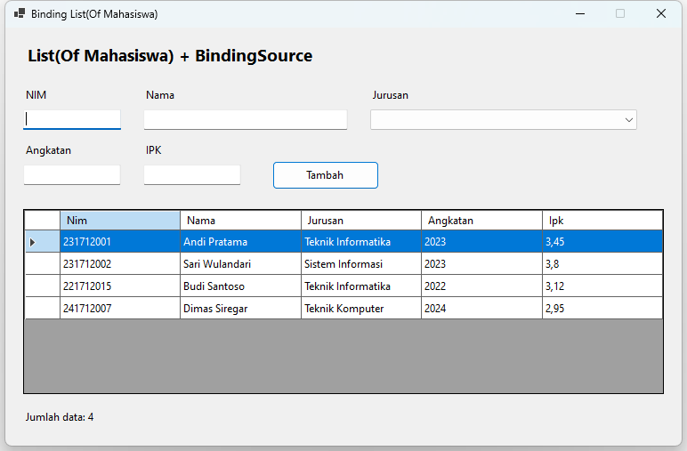

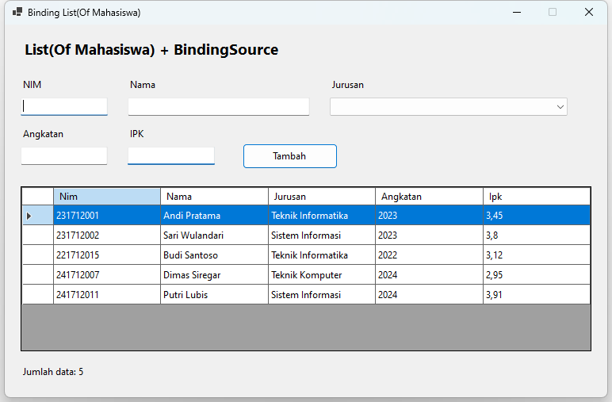

## Praktik 3: DataTable, Rapikan Kolom, dan Filter

### 3.1 Membuat Module pencarian

Tambahkan Module baru `ModPencarian.vb`, lalu isi:

```vb
Option Strict On

' Fungsi bantu untuk BindingSource.Filter
Public Module ModPencarian

    ' Mengamankan karakter khusus agar tidak merusak ekspresi Filter.
    ' Kutip tunggal digandakan; [ ] * % dibungkus kurung siku.
    Public Function AmankanTeksFilter(teks As String) As String
        Dim hasil As String = ""
        For Each karakter As Char In teks
            Select Case karakter
                Case "'"c
                    hasil &= "''"
                Case "["c, "]"c, "*"c, "%"c
                    hasil &= "[" & karakter & "]"
                Case Else
                    hasil &= karakter
            End Select
        Next
        Return hasil
    End Function

End Module
```

### 3.2 Membuat form

1. Tambahkan form baru `FrmDataTable.vb`, lalu atur propertinya:

| Properti | Nilai |
|---|---|
| Text | DataTable, BindingSource & Filter |
| ClientSize | 760; 470 |
| StartPosition | CenterScreen |
| FormBorderStyle | FixedSingle |
| MaximizeBox | False |

2. Tambahkan kontrol berikut:

| Kontrol | (Name) | Text | Properti lain |
|---|---|---|---|
| Label | lblJudul | DataTable + BindingSource | Font: Segoe UI, 14pt, Bold |
| Label | lblCari | Cari nama/NIM: | |
| TextBox | txtCari | | |
| Button | btnRapikan | Rapikan Kolom | |
| DataGridView | dgvMahasiswa | | AllowUserToAddRows: False, AllowUserToDeleteRows: False, ReadOnly: True, SelectionMode: FullRowSelect, MultiSelect: False |
| Label | lblJumlah | Menampilkan 0 dari 0 data | |

3. Tambahkan **BindingSource** dengan `(Name)` `bsMahasiswa`.
4. Biarkan `AutoSizeColumnsMode` grid tetap None. Pengaturan kolom dilakukan lewat kode di tombol Rapikan Kolom, supaya tampilan sebelum dan sesudahnya bisa dibandingkan.

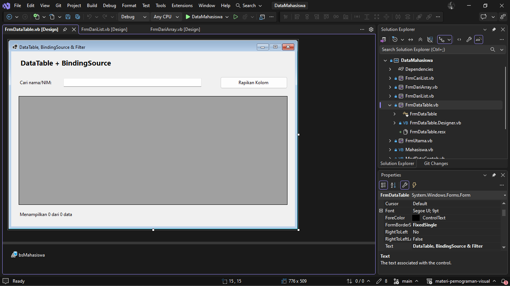

### 3.3 Menulis kode

Buat event `Load` (double-click form), `btnRapikan_Click` (double-click tombol), dan `txtCari_TextChanged` (double-click txtCari), lalu lengkapi `FrmDataTable.vb`:

```vb
Option Strict On

Public Class FrmDataTable
    Private tabelMahasiswa As DataTable

    Private Function BuatTabelMahasiswa() As DataTable
        Dim tabel As New DataTable("Mahasiswa")
        ' Kolom: nama dan tipe data
        tabel.Columns.Add("Nim", GetType(String))
        tabel.Columns.Add("Nama", GetType(String))
        tabel.Columns.Add("Jurusan", GetType(String))
        tabel.Columns.Add("Angkatan", GetType(Integer))
        tabel.Columns.Add("Ipk", GetType(Decimal))
        ' Baris: urutan nilai mengikuti urutan kolom
        tabel.Rows.Add("231712001", "Andi Pratama", "Teknik Informatika", 2023, 3.45D)
        tabel.Rows.Add("231712002", "Sari Wulandari", "Sistem Informasi", 2023, 3.8D)
        tabel.Rows.Add("221712015", "Budi Santoso", "Teknik Informatika", 2022, 3.12D)
        tabel.Rows.Add("241712007", "Dimas Siregar", "Teknik Komputer", 2024, 2.95D)
        tabel.Rows.Add("221712020", "Rina Marpaung", "Manajemen Informatika", 2022, 3.5D)
        tabel.Rows.Add("241712011", "Putri Lubis", "Sistem Informasi", 2024, 3.91D)
        tabel.Rows.Add("231712019", "Fajar Nasution", "Teknik Informatika", 2023, 3.28D)
        tabel.Rows.Add("221712031", "Maya Sari Hasibuan", "Teknik Komputer", 2022, 3.55D)
        Return tabel
    End Function

    Private Sub FrmDataTable_Load(sender As Object, e As EventArgs) Handles MyBase.Load
        tabelMahasiswa = BuatTabelMahasiswa()
        bsMahasiswa.DataSource = tabelMahasiswa         ' DataTable -> BindingSource
        dgvMahasiswa.DataSource = bsMahasiswa           ' BindingSource -> DataGridView
        PerbaruiJumlah()
    End Sub

    Private Sub PerbaruiJumlah()
        lblJumlah.Text = "Menampilkan " & bsMahasiswa.Count.ToString() & " dari " &
                         tabelMahasiswa.Rows.Count.ToString() & " data"
    End Sub

    ' Kolom dibuat otomatis saat DataSource diisi, jadi pengaturannya dilakukan sesudahnya
    Private Sub AturKolom()
        dgvMahasiswa.Columns("Nim").HeaderText = "NIM"
        dgvMahasiswa.Columns("Ipk").HeaderText = "IPK"
        dgvMahasiswa.Columns("Ipk").DefaultCellStyle.Format = "N2"
        dgvMahasiswa.Columns("Ipk").DefaultCellStyle.Alignment = DataGridViewContentAlignment.MiddleRight
        dgvMahasiswa.Columns("Angkatan").DefaultCellStyle.Alignment = DataGridViewContentAlignment.MiddleCenter
        dgvMahasiswa.Columns("Nama").FillWeight = 200
        dgvMahasiswa.AutoSizeColumnsMode = DataGridViewAutoSizeColumnsMode.Fill
    End Sub

    Private Sub btnRapikan_Click(sender As Object, e As EventArgs) Handles btnRapikan.Click
        AturKolom()
    End Sub

    Private Sub txtCari_TextChanged(sender As Object, e As EventArgs) Handles txtCari.TextChanged
        Dim kata As String = AmankanTeksFilter(txtCari.Text.Trim())
        If kata = "" Then
            bsMahasiswa.RemoveFilter()                  ' tampilkan semua data
        Else
            ' Ekspresi Filter milik DataTable, diproses di memori, bukan perintah SQL
            bsMahasiswa.Filter = "Nama LIKE '%" & kata & "%' OR Nim LIKE '%" & kata & "%'"
        End If
        PerbaruiJumlah()
    End Sub
End Class
```

### 3.4 Menghubungkan ke FrmUtama

Di FrmUtama, tambahkan tombol `btnDataTable` dengan Text `3. DataTable, Rapikan Kolom dan Filter`. Double-click, lalu isi:

```vb
    Private Sub btnDataTable_Click(sender As Object, e As EventArgs) Handles btnDataTable.Click
        Dim frm As New FrmDataTable()
        frm.ShowDialog()
    End Sub
```

### 3.5 Menjalankan dan menguji

| No | Langkah | Hasil yang benar |
|---|---|---|
| 1 | Buka form | Grid berisi 8 data, lblJumlah "Menampilkan 8 dari 8 data" |
| 2 | Klik judul kolom **Ipk** | Data terurut berdasarkan IPK; klik sekali lagi untuk urutan terbalik |
| 3 | Klik **Rapikan Kolom** | Judul kolom menjadi NIM dan IPK, IPK selalu dua desimal dan rata kanan, kolom Nama lebih lebar, grid memenuhi lebarnya |
| 4 | Ketik `sari` di kotak cari | Tampil 2 data (Sari Wulandari dan Maya Sari Hasibuan), lblJumlah "Menampilkan 2 dari 8 data" |
| 5 | Ketik `2317` | Tampil data yang NIM-nya mengandung 2317 |
| 6 | Ketik tanda kutip `'` | Tidak ada error; grid kosong karena tidak ada yang cocok |
| 7 | Kosongkan kotak cari | Semua 8 data tampil kembali |

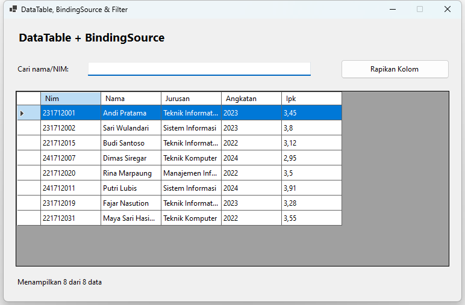

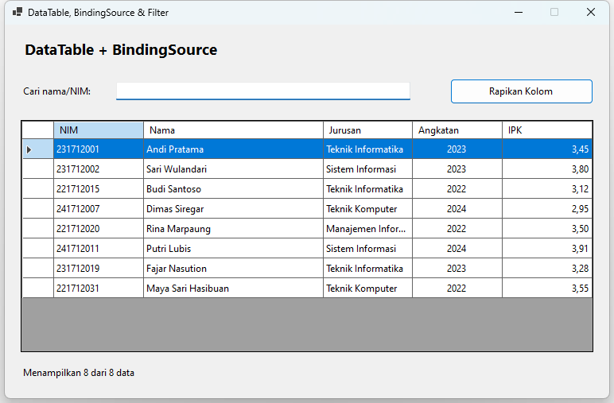

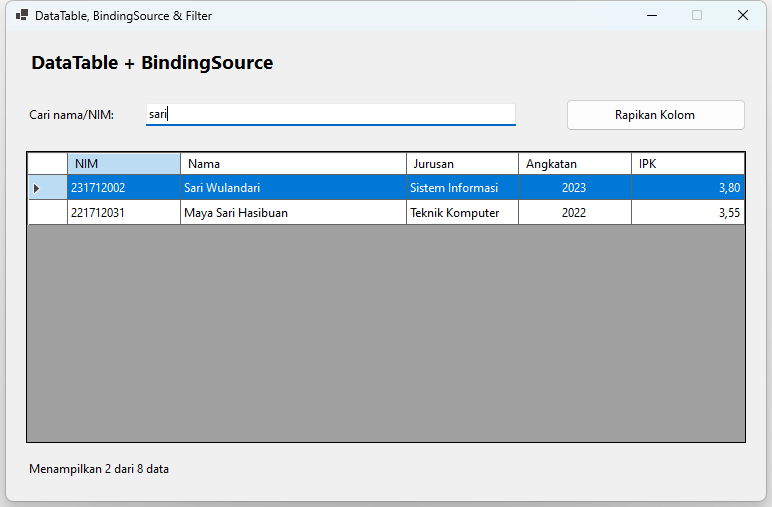

## Praktik 4: Pencarian dengan Perulangan

### 4.1 Membuat Module data contoh

Tambahkan Module baru `ModDataContoh.vb`, lalu isi:

```vb
Option Strict On

Public Module ModDataContoh
    ' Membuat daftar baru agar data tiap form tetap terpisah.
    Public Function BuatDaftarMahasiswa() As List(Of Mahasiswa)
        Dim daftar As New List(Of Mahasiswa)
        daftar.Add(New Mahasiswa("231712001", "Andi Pratama", "Teknik Informatika", 2023, 3.45D))
        daftar.Add(New Mahasiswa("231712002", "Sari Wulandari", "Sistem Informasi", 2023, 3.8D))
        daftar.Add(New Mahasiswa("221712015", "Budi Santoso", "Teknik Informatika", 2022, 3.12D))
        daftar.Add(New Mahasiswa("241712007", "Dimas Siregar", "Teknik Komputer", 2024, 2.95D))
        daftar.Add(New Mahasiswa("221712020", "Rina Marpaung", "Manajemen Informatika", 2022, 3.5D))
        daftar.Add(New Mahasiswa("241712011", "Putri Lubis", "Sistem Informasi", 2024, 3.91D))
        daftar.Add(New Mahasiswa("231712019", "Fajar Nasution", "Teknik Informatika", 2023, 3.28D))
        daftar.Add(New Mahasiswa("221712031", "Maya Sari Hasibuan", "Teknik Komputer", 2022, 3.55D))
        Return daftar
    End Function
End Module
```

### 4.2 Membuat form

1. Tambahkan form baru `FrmCariList.vb`, lalu atur propertinya:

| Properti | Nilai |
|---|---|
| Text | Pencarian dengan Perulangan |
| ClientSize | 720; 430 |
| StartPosition | CenterScreen |
| FormBorderStyle | FixedSingle |
| MaximizeBox | False |

2. Tambahkan kontrol berikut, lalu tambahkan **BindingSource** dengan `(Name)` `bsMahasiswa`:

| Kontrol | (Name) | Text | Properti lain |
|---|---|---|---|
| Label | lblJudul | Mencari di List(Of Mahasiswa) | Font: Segoe UI, 14pt, Bold |
| Label | lblCari | Cari nama/NIM: | |
| TextBox | txtCari | | |
| DataGridView | dgvMahasiswa | | AllowUserToAddRows: False, AllowUserToDeleteRows: False, ReadOnly: True, SelectionMode: FullRowSelect, MultiSelect: False, AutoSizeColumnsMode: Fill |
| Label | lblJumlah | Menampilkan 0 data | |

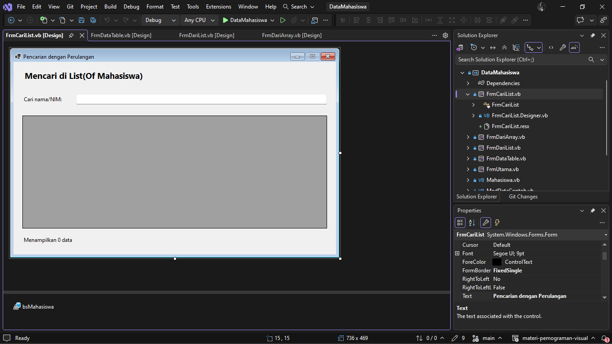

### 4.3 Menulis kode

Buat event `Load` dan `txtCari_TextChanged`, lalu lengkapi `FrmCariList.vb`:

```vb
Option Strict On

Public Class FrmCariList
    Private daftarMahasiswa As List(Of Mahasiswa)

    Private Sub FrmCariList_Load(sender As Object, e As EventArgs) Handles MyBase.Load
        daftarMahasiswa = BuatDaftarMahasiswa()
        bsMahasiswa.DataSource = daftarMahasiswa
        dgvMahasiswa.DataSource = bsMahasiswa
        lblJumlah.Text = "Menampilkan " & daftarMahasiswa.Count.ToString() & " data"
    End Sub

    ' List(Of T) tidak mendukung BindingSource.Filter, jadi pencarian dilakukan dengan perulangan
    Private Sub txtCari_TextChanged(sender As Object, e As EventArgs) Handles txtCari.TextChanged
        Dim kata As String = txtCari.Text.Trim().ToLower()
        Dim hasil As New List(Of Mahasiswa)
        For Each mhs As Mahasiswa In daftarMahasiswa
            If mhs.Nama.ToLower().Contains(kata) OrElse mhs.Nim.Contains(kata) Then
                hasil.Add(mhs)
            End If
        Next
        bsMahasiswa.DataSource = hasil
        lblJumlah.Text = "Menampilkan " & hasil.Count.ToString() & " dari " &
                         daftarMahasiswa.Count.ToString() & " data"
    End Sub
End Class
```

### 4.4 Menghubungkan ke FrmUtama

Di FrmUtama, tambahkan tombol `btnCariList` dengan Text `4. Pencarian dengan Perulangan`. Double-click, lalu isi:

```vb
    Private Sub btnCariList_Click(sender As Object, e As EventArgs) Handles btnCariList.Click
        Dim frm As New FrmCariList()
        frm.ShowDialog()
    End Sub
```

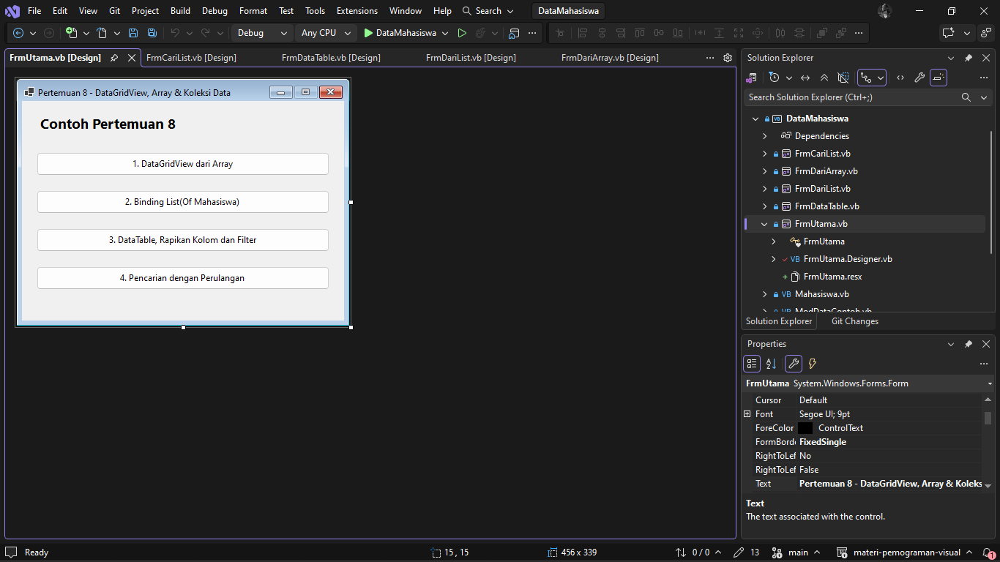

### 4.5 Menjalankan dan menguji

| No | Langkah | Hasil yang benar |
|---|---|---|
| 1 | Buka form | Grid berisi 8 data, lblJumlah "Menampilkan 8 data" |
| 2 | Ketik `sari` | Tampil 2 data, lblJumlah "Menampilkan 2 dari 8 data" |
| 3 | Ketik `SARI` (huruf besar) | Hasilnya sama dengan langkah 2 |
| 4 | Ketik `2317` | Tampil 3 data dengan NIM berawalan 2317 |
| 5 | Kosongkan kotak cari | Semua 8 data tampil kembali |

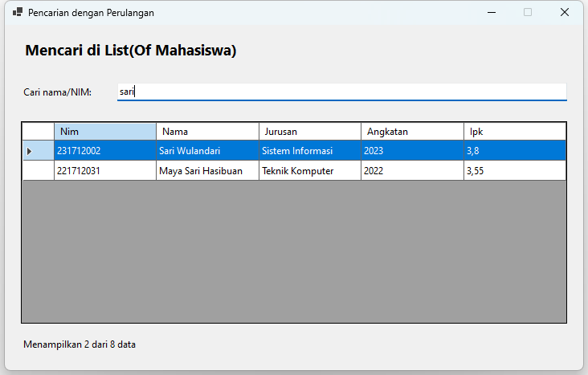
